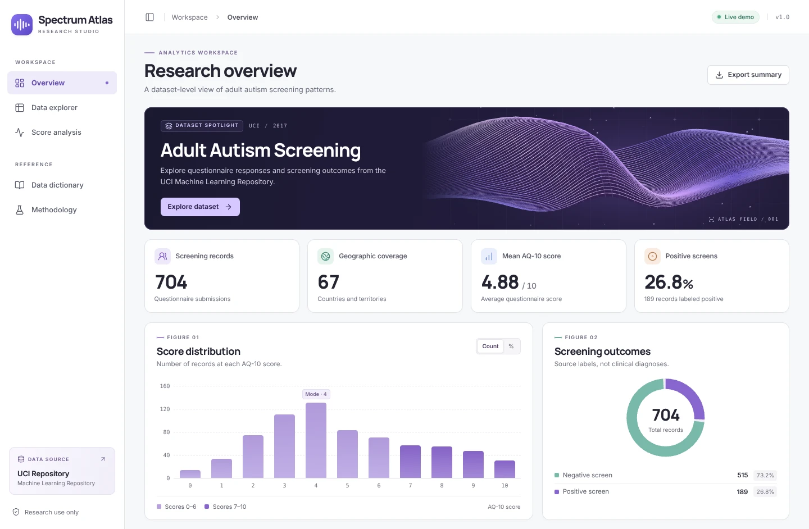

# Spectrum Atlas

**An interactive research workspace for adult autism screening data.** Explore 704 published questionnaire records, trace each chart back to its underlying cohort, and see why a screening label is not a diagnosis.

[Run the demo](#run-the-demo) · [Data & provenance](data/README.md) · [Publish a public demo](docs/deployment.md) · [دليل العرض للمقابلة](docs/portfolio-guide.ar.md)



## The question

What patterns appear in the ten scored questionnaire items, and how much information does the published screening label add beyond the score itself?

| Cohort | Geographic coverage | Mean score | Most frequent score | Positive screening label |
| ---: | ---: | ---: | ---: | ---: |
| 704 records | 67 countries / territories | 4.875 / 10 | 4 (131 records) | 189 / 704 (26.8%) |

**The key finding is a limitation.** In this dataset every YES label coincides with a total of 7–10, and every NO label with 0–6. Predicting that label from the same items would reproduce the screening rule, not establish diagnostic accuracy. This project therefore focuses on descriptive, auditable exploration rather than a misleading classifier benchmark.

## A 60-second tour

1. **Overview:** switch the score chart between counts and percentages. Select the bar at **4** to open exactly the **131** records behind it.
2. **Data explorer:** combine country/ID search, age band, score, and screening label. Sort, paginate, open an item-level record, or export the entire filtered cohort. Filters are encoded in the URL fragment for sharing.
3. **Score analysis:** choose an age band. The denominator, item profile, distribution, and downloadable summary all change together. The **Unknown** band keeps three records that an age-only analysis could silently lose.
4. **Reference:** use the searchable field dictionary and methodology notes to audit the transformations, attribution, label leakage, and limitations.

## Run the demo

Requires **Node.js 22.12+** and npm. No environment variables, credentials, Python packages, or backend service are required to run the app.

```bash
npm ci
npm run dev
```

Open the URL printed by Vite (default port `5173`). In Arena, open **Spectrum Atlas · Live demo** in the Live Preview panel. For a long-lived, recruiter-facing link, follow the [public deployment guide](docs/deployment.md).

```bash
npm run build       # strict TypeScript check + production bundle in dist/
npm run preview     # serve the production bundle locally
# Or, with the dev server stopped:
npm run demo        # build and serve the presentation on port 5173
```

## Engineering notes

- **One source of truth:** React + TypeScript views share pure filter, aggregation, sort, and export functions. The charts, tables, and CSVs run on the same local snapshot, not hard-coded figure values.
- **Reproducible data preparation:** a standard-library Python script validates the ARFF schema, ten binary fields, row shape, and every item sum against the reported total. Only a compact subset of fields is distributed.
- **Accessible interactions:** charts have keyboard-operable drill-down links with text values, sortable table headers expose sort order, dialogs support Escape and focus return, and the layout works with reduced motion and narrow screens.
- **Portable delivery:** Vite builds static assets, including locally served fonts. No analytics trackers or clinical prediction endpoint. CSV exports carry dataset attribution.

```text
data/                Curated snapshot, citation, and transformation decisions
scripts/             Reproducible ARFF → research snapshot preparation
src/components/      Navigation, charts, record table, and dialogs
src/lib/             Typed cohort operations, routing, and exports
src/pages/           Overview, explorer, score analysis, and references
src/styles/          Workspace, dashboard, and page styles
public/              Original brand assets and third-party notices
tests/               Data integrity, preparation, and browser interaction tests
docs/                Portfolio walkthrough, screenshot, and deployment guide
.github/workflows/   Verification and opt-in GitHub Pages publishing
```

## Verify

```bash
npm test                               # snapshot, analytics, filtering, CSVs
python3 -m unittest discover -s tests   # source transformation and error cases
npm run format:check
npm run build
npx playwright install chromium        # once; use --with-deps on Linux CI
npm run test:e2e                       # tests the built app in Chromium
```

The browser tests cover chart drill-down, filter persistence, record details, filtered downloads, sorting, pagination, reference search, and mobile navigation. See the [data card](data/README.md) to reproduce the snapshot from the pinned input.

## Attribution and intended use

Thabtah, F. (2017). *Autism Screening Adult* [Dataset]. UCI Machine Learning Repository. [10.24432/C5F019](https://doi.org/10.24432/C5F019). The curated snapshot is adapted under [CC BY 4.0](https://creativecommons.org/licenses/by/4.0/); modifications are documented in the data card. The decorative field illustration is not a scan or a participant measurement.

These records describe one screening cohort. They do not estimate population prevalence, establish causation, or provide an independent clinical diagnosis. **Do not use this demo to assess individuals for clinical, hiring, or eligibility decisions.**
